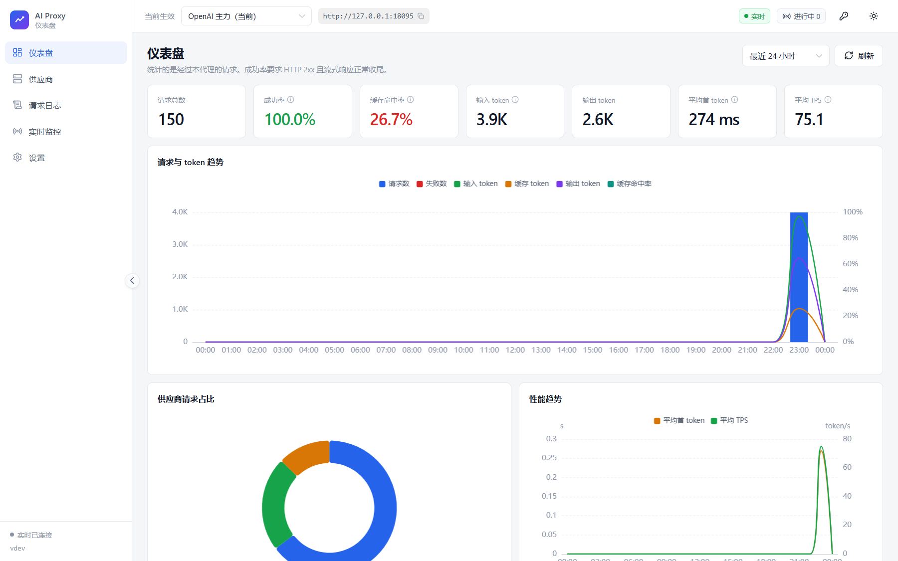
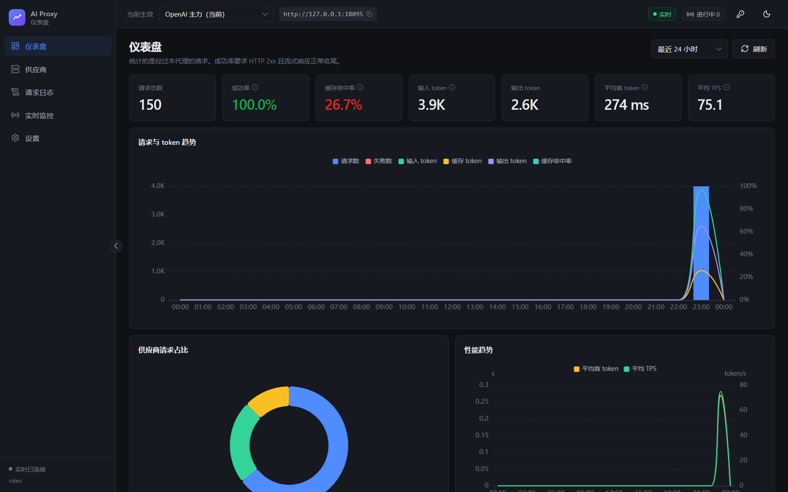
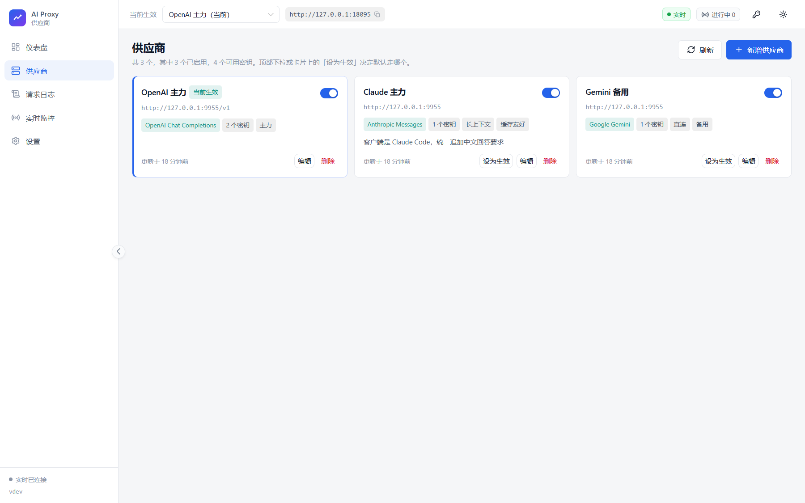
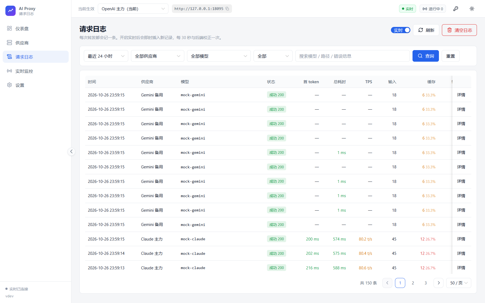
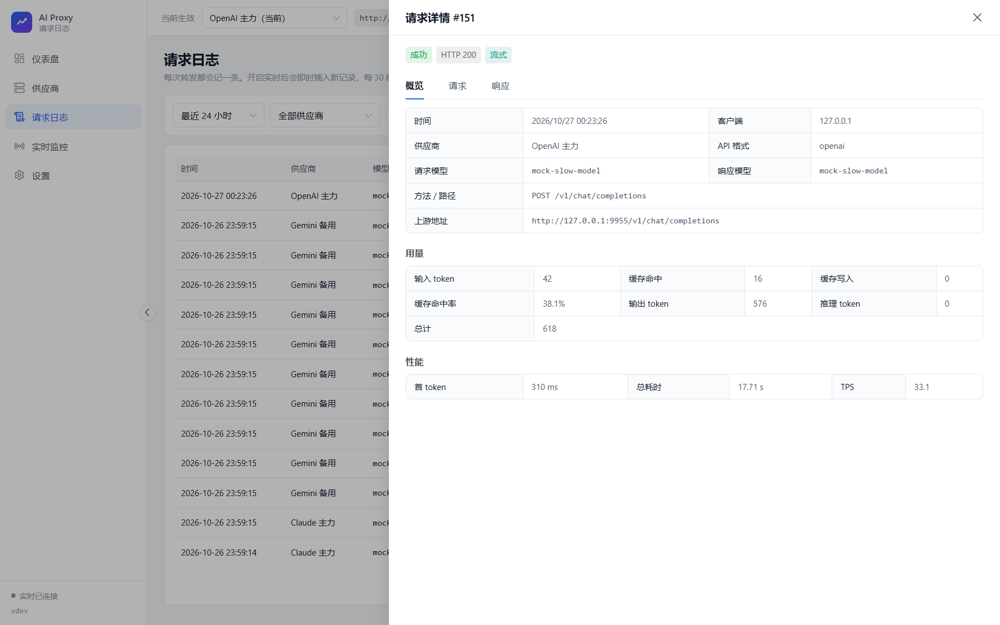
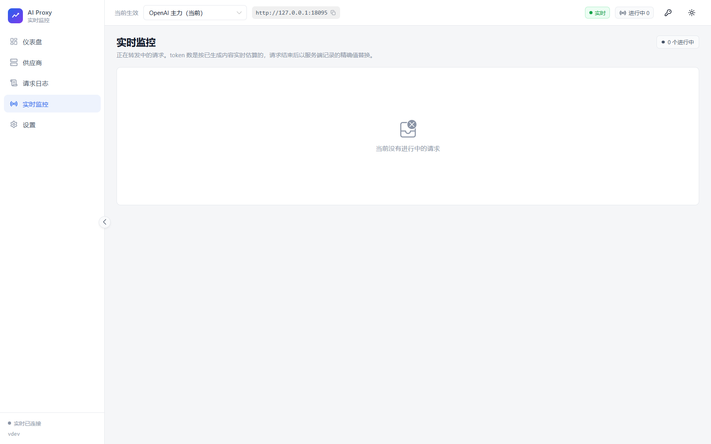
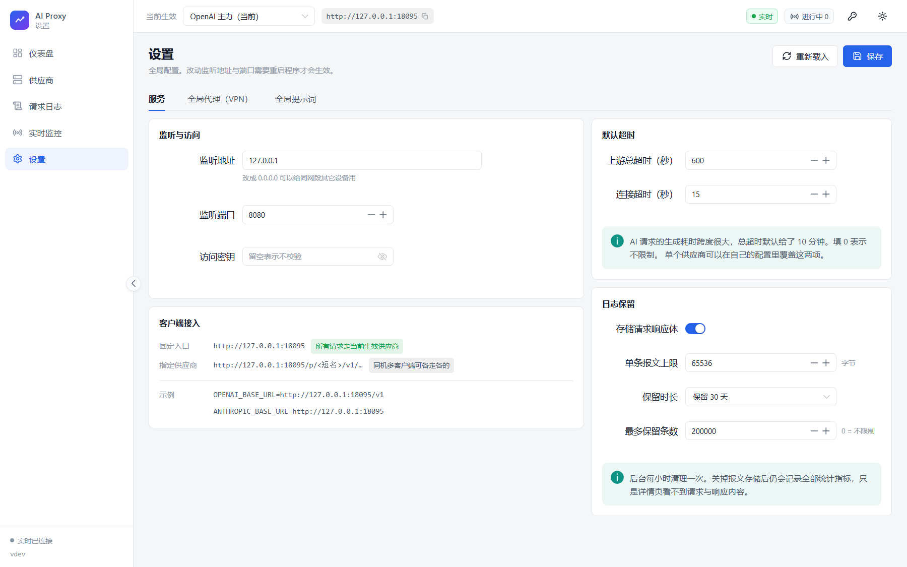

# AI Proxy

面向 AI 模型供应商的透明代理转发程序。把客户端的 `base_url` 指过来，请求原样转发到上游，
同时在本地记录每次调用的完整指标：输入 / 缓存 / 输出 token、首 token 耗时、总耗时、TPS、
HTTP 状态、推理强度等。

提供两种形态，共用同一套内核与界面：

- **桌面版**（`ai_proxy-desktop.exe`）：原生窗口，双击即用（Windows）。
- **服务端版**（`ai_proxy-server.exe`）：命令行启动、监听端口，适合服务器与脚本部署。

两种形态都是单文件，前端资源通过 `go:embed` 内嵌，无需额外部署。

## 特性

- **透明转发**：不改格式、不裁字段。请求与响应按原字节透传，SSE 流式逐事件转发。
- **全程记账**：解析 5 种协议格式的用量与性能指标，落 SQLite，带实时推送的管理界面。
- **自定义提示词**：全局默认 + 按供应商覆盖 + 按模型正则匹配，三种注入方式，改动全程留痕。
- **模型映射**：按供应商把请求的模型名精确映射成上游模型名，未命中的请求原样透传（见下文）。
- **Responses 会话续传**：对开启的供应商，把多轮 Responses 请求的全量历史截成增量，配合
  `store:true` + `previous_response_id` 降低多图会话的首 token 耗时；默认关闭，支持 dry-run 诊断（见下文）。
- **全局代理**：支持 HTTP / SOCKS5，可按供应商覆盖或直连，支持 no_proxy 例外表。
- **多供应商**：一个端口挂多个上游，前端切换「当前生效」，也可用路径前缀显式指定。
- **多密钥轮询**：一个供应商配多个密钥，自动轮询，失败自动进入冷却并避让。
- **套餐余量查询**：按供应商选一个内置模板，读回剩余额度与滚动窗口限额（见下文）。
- **图片压缩**：请求体里的内联图片超过阈值或长边超限时等比缩放重编码，默认开启，日志留痕（见下文）。
- **图片数量兜底**：上游对单请求图片总数有硬上限（Mistral 超 20 张直接 400）时，
  保留最新 N 张、更早的换成占位文本，让会话不至于永久报废（按供应商配置，见下文）。
- **开机自启**：设置页一个开关，登录时自动启动；桌面版直接收进托盘，不打扰（见下文）。
- **一键更新**：启动时自动查 GitHub Release，发现新版本弹框确认后下载、校验 SHA-256、
  替换并重启，也可以跳过某个版本（见下文）。

## 界面预览

管理界面由程序自己提供，和代理入口共用同一个端口。桌面版直接开窗显示它；
服务端版启动后打开 `http://127.0.0.1:8080/` 即可。两种形态看到的是同一套界面。

下面这些截图取自一台本机演示实例（上游指向本地模拟上游），不涉及任何真实账号与密钥。

**仪表盘** —— 请求量、成功率、缓存命中率、token、首 token 耗时与 TPS 的汇总，
下面按时间桶展开请求与 token 趋势、性能曲线、供应商占比和模型排行。



**暗色主题** —— 亮/暗两套都完整适配（含图表与状态色），也可以跟随系统自动切换。



**供应商** —— 一个端口挂多个上游：API 格式、密钥数量、代理方式、自定义标签都摆在卡片上，
当前生效的那张带蓝色左竖条与细描边；配了套餐查询的供应商还会显示剩余额度与各窗口用量。



**请求日志** —— 每次调用的完整指标，可按时间、供应商、模型、状态筛选，或按关键字搜索；
首 token、总耗时、TPS 与缓存命中率都按档位着色。



**日志详情** —— 用量与性能的精确值，以及本次请求的改写留痕；改写前的请求体也留在库中，
可以在「请求」标签页里和实际发出的那份对照。



**实时监控** —— 正在转发的请求每 0.7 秒推送一次，已生成 token、实时 TPS 与首 token 等待状态都在上面。



**设置** —— 监听地址与访问密钥、客户端接入示例、默认超时、日志保留策略、开机自启、版本更新；
另有「全局代理（VPN）」「全局提示词」「请求改写」三个标签页。桌面版还会多一个「桌面应用」标签页
（关闭行为、数据/日志目录、版本号）。



## 快速开始

### 1. 构建

需要 Go 1.25+ 与 Node 18+。

```bash
# Linux / macOS / Git Bash
make release

# Windows 命令行（cmd 或 PowerShell）
build.bat
```

`make release` / `build.bat` 会先构建前端（`web/dist`），再把它嵌进 Go 二进制。
`build.bat` 现在产出两份：

| 产物 | 说明 |
|---|---|
| `dist\ai_proxy-desktop.exe` | 桌面版，Windows GUI 子系统，带图标与版本信息 |
| `dist\ai_proxy-server.exe` | 服务端版，控制台子系统，行为与旧版一致 |

`make dist` 等价于 Windows 上的 `build.bat` 双产物构建；`make release` 只产出服务端形态。

桌面版的构建需要多一步 Windows 资源：

```bash
go run scripts/gen-icon/main.go                  # 生成 build/windows/app.ico
go run scripts/gen-rc/main.go -version 0.2.3     # 生成 build/windows/app.rc（含版本号）
cd build/windows && windres --target=pe-x86-64 -i app.rc -o ../../internal/winres/rsrc_windows_amd64.syso -O coff -c 65001
```

`build.bat` 会自动完成这三步，并自动定位 `windres`（优先 `D:\TDM-GCC-64\bin`）。
`-c 65001` 不能省：`app.rc` 里的中文是 UTF-8，按默认 ANSI 读会变成 exe 属性里的乱码。

两个脚本都不依赖 PATH 上的 `go`：它们直接调用版本目录里的高版本
`D:\Program Files\g\versions\1.25.4\bin\go.exe`，并把 `GOROOT` 指到同一目录
（只在脚本内生效）。这是必要的 —— `g` 的 `...\g\go` 指针和机器级 `GOROOT`
可能停在旧版本（本机是 1.19），直接用 PATH 上的 `go` 会拿错标准库。
想换版本就改脚本里的 `GO_HOME`（Makefile 里是 `GO_DIR`）。

也可以分两步手动执行（同样要用上面那个 go，或自行 export 匹配的 `GOROOT`）：

```bash
cd web && npm install && npm run build && cd ..
"D:\Program Files\g\versions\1.25.4\bin\go.exe" build -o ai_proxy.exe .
```

> 程序正在运行时也可以重新构建（Windows 允许替换已映射的可执行文件），
> 但**旧进程跑的仍是旧代码，要重启才生效**。`build.bat` 会提醒这一点。
>
> `build.bat` 刻意只使用 ASCII 字符：cmd.exe 按控制台的 OEM 代码页（简体中文 Windows
> 上是 936/GBK）逐字节读取 `.bat`，不认 UTF-8，写中文注释会让脚本被解析成乱码命令。
> 同理，脚本里的外部命令用绝对路径调用 —— 从 Git Bash 启动时 `find` 会解析到 MSYS 的
> GNU find 而不是 Windows 的。

#### 自动发布

推 `v*` 标签会触发 `.github/workflows/release.yml`，在 `windows-latest` 上构建两个 exe
并自动创建 GitHub Release：

```bash
git tag v0.2.3
git push origin v0.2.3
```

也可以在 Actions 页面手动运行 `Release` 工作流，填版本号并勾选 `publish` 来发版；
不勾选时只构建并保留 Actions artifact。Release 附件包含
`ai_proxy-server.exe`、`ai_proxy-desktop.exe` 与 `SHA256SUMS.txt`。

### 2. 运行

**桌面版**（推荐）：

```bash
dist\ai_proxy-desktop.exe
```

双击即可，不需要命令行参数，也不需要手动打开浏览器。

**服务端版**：

```bash
./ai_proxy.exe
```

打开 <http://127.0.0.1:8080/> 进入管理界面。

命令行参数（两种形态都接受，桌面版通常不需要）：

| 参数 | 默认值 | 说明 |
|---|---|---|
| `-host` | 设置里的值（127.0.0.1） | 监听地址 |
| `-port` | 设置里的值（8080） | 监听端口，优先级高于界面设置 |
| `-data` | 服务端 `data`；桌面版见下 | 数据目录，存放 SQLite 数据库 |
| `-debug` | `false` | 输出调试日志 |

#### 桌面版的工作方式

窗口加载的是进程内已经跑起来的本地 HTTP 服务（`http://127.0.0.1:<端口>/`），
不是另外打包的一套前端。所以**浏览器访问仍然可用**：桌面版运行期间，同机任何程序
都可以打开同一个地址，也能把它当作代理入口给客户端用。

几个与命令行版不同、需要知道的行为：

| 行为 | 说明 |
|---|---|
| 数据目录 | 优先沿用 exe 同目录的 `data\`（若其中已有 `ai_proxy.db`），否则用 `%APPDATA%\ai_proxy`。用 `-data` 可强制指定 |
| 日志 | 同时写 stdout 与 `<数据目录>\logs\ai_proxy.log`，5 MB 轮转、保留 5 份。GUI 子系统没有控制台，文件日志是排障主入口 |
| 关闭窗口 | 默认弹三选一：退出 / 托盘运行 / 取消，可勾选记住选择。之后可在「设置 → 桌面应用」修改 |
| 托盘运行 | 窗口隐藏到系统托盘，**代理继续运行**，客户端连接不中断；双击托盘图标重新打开，右键菜单可退出 |
| 单实例 | 重复启动只会把已有窗口叫到前台，不会开第二个进程 |
| 端口占用 | 启动时若端口被占，会询问是否自动换到下一个可用端口；界面上的接入地址始终显示实际端口。**被开机自启拉起时不弹窗**，直接交给系统分配端口 |
| 开机自启 | 在「设置 → 服务」打开后，登录时自动启动并**隐藏到托盘**；双击托盘图标打开窗口。托盘创建失败时会自动把窗口显示出来，不会留下看不见的进程 |
| WebView2 | 需要系统安装 Microsoft Edge WebView2 Runtime。Windows 11 与较新的 Windows 10 通常已自带 |

日志里出现 `未检测到 WebView2 Runtime` 时，装一次
<https://developer.microsoft.com/microsoft-edge/webview2/> 的 Evergreen Runtime 即可。

#### 桌面版的边界

- **暂只支持 Windows**。代码结构已按平台隔离（`internal/desktop` + `desktop_windows.go`），
  但 Linux 桌面壳尚未实现。Linux 上继续使用服务端版。
- 关闭行为、数据目录、版本号都在「设置 → 桌面应用」里可见可改。

### 3. 配置供应商
在「供应商」页新增一个上游，至少填两项：

- **BaseURL**：例如 `https://api.openai.com/v1`。填不填 `/v1` 都可以，重复的路径段会自动去重。
- **API 格式**：决定去哪儿读用量、提示词注入到哪个字段。程序不会做格式转换。

密钥可以不填 —— 那时客户端自带的认证信息会原样转发给上游，适合「客户端持钥、代理只记账」的用法。

### 4. 接入客户端

```
固定入口（走当前生效供应商）  http://127.0.0.1:8080
指定供应商                    http://127.0.0.1:8080/p/<供应商短名>
```

一个端口同时支持所有路径，所以不同客户端可以指向同一个地址：

```bash
# OpenAI SDK
export OPENAI_BASE_URL=http://127.0.0.1:8080/v1
export OPENAI_API_KEY=sk-anything        # 密钥由代理侧注入

# Claude Code
export ANTHROPIC_BASE_URL=http://127.0.0.1:8080
export ANTHROPIC_API_KEY=sk-anything
```

同机多个客户端想各走各的供应商时，用短名路由：

```bash
export OPENAI_BASE_URL=http://127.0.0.1:8080/p/openai-主力/v1
export ANTHROPIC_BASE_URL=http://127.0.0.1:8080/p/claude-备用
```

### 5. 设置了访问密钥之后

监听 `0.0.0.0` 时建议在「设置 → 服务」里配置访问密钥，否则同网段的任何人都能用这个代理、
看全部请求日志。

**浏览器访问**：直接打开地址即可。管理界面的静态资源不要求密钥，页面会弹出一个输入框，
把密钥填进去就行 —— 存在浏览器本地，之后不用再输。

**脚本 / 客户端访问**：代理入口与管理接口都要求密钥，三种送法任选：

```bash
# 请求头（推荐）
curl -H "X-AI-Proxy-Key: <密钥>" http://127.0.0.1:8080/api/settings

# Authorization（把代理密钥当成 API key 用，客户端接入最省事）
export OPENAI_API_KEY=<密钥>

# 查询参数（仅用于 EventSource 这类无法自定义请求头的场景）
http://127.0.0.1:8080/api/events?key=<密钥>
```

客户端用 `Authorization` 送过来的代理密钥**不会被转发到上游**：那是给本代理看的凭据。
供应商自己没有配置密钥（「客户端持钥」模式）时，这一点尤其重要，否则会把代理密钥泄露给上游。

### 6. 开机自启

「设置 → 服务 → 开机自启」打开即可，**开关一拨就生效**，不走页面的「保存」按钮。

两种形态各写一条启动项，互不覆盖：

| 形态 | 启动项名 | 行为 |
|---|---|---|
| 桌面版 | `AIProxy-Desktop` | 登录后启动，窗口隐藏到系统托盘，双击托盘图标打开 |
| 服务端版 | `AIProxy-Server` | 登录后以控制台方式启动 |

实现细节与几个容易踩的点：

- 写的是 `HKCU\Software\Microsoft\Windows\CurrentVersion\Run`，**不需要管理员权限**。
  用当前用户而不是机器级，是因为「我这个用户登录时启动」才是正确的语义。
- 状态以注册表为唯一事实来源，数据库里不留副本 —— 否则用户在任务管理器里关掉启动项之后，
  库里的「已开启」就成了谎话。界面读到的永远是系统里的真实现状。
- 命令里的 exe 路径一律加引号（`Program Files` 必然带空格）。
- **服务端形态的 `-data` 写成绝对路径**。默认值是相对当前目录的 `data`，而登录时的工作目录是
  `System32`，相对路径会直接建库失败 —— 这是「自启能开但一启动就崩」的经典坑。
- 桌面形态只在用户显式传过 `-data` 时才写进启动项：留空时 exe 会按「同级 `data` →
  `%APPDATA%`」重新解析，把数据目录焊死在命令行里反而会让用户挪动 exe 后失效。
- 把 exe 挪到别的目录后，界面会提示「启动项指向的是旧路径」，关掉再打开一次开关即可更新。
- `go run` 调试形态（可执行文件在临时目录）会被明确拒绝，并说明原因。

### 7. 检测更新

更新包来自 GitHub Release（`fengxinzi-mulan/ai_proxy`），复用现有发布流程产出的
`ai_proxy-desktop.exe` / `ai_proxy-server.exe` / `SHA256SUMS.txt`。

**什么时候查**：启动后延迟 8 秒自动查一次（失败只记 debug 日志，断网是常态），
「设置 → 服务 → 版本与更新」里也能手动查。自动检查有 6 小时最小间隔 ——
GitHub 未认证 API 是 60 次/小时/IP，没必要把配额耗在重复请求上；手动检查不受此限。

**发现新版本之后**：弹确认框（也可以点侧边栏的版本号手动打开），显示版本号、包大小与发布说明，
三个选择：

- **立即更新**：下载 → 校验 SHA-256 → 替换 exe → 自动重启。进度条实时推进。
- **跳过此版本**：记住这个版本，之后自动检查不再弹框；手动检查仍能看见，设置页可「不再跳过」。
- **稍后**：本次会话不再打扰。

几个关键设计：

- **校验不过绝不安装**。优先用 Release 里 GitHub 服务端算的 `digest`，没有就回退到
  `SHA256SUMS.txt`；两者都拿不到时直接拒绝 —— 宁可让用户手动下载，也不装一个来源不明的 exe。
- **替换是原子的**。Windows 不允许覆盖运行中的 exe，但允许改名，所以流程是
  「旧 exe 改名为 `.old-<时间戳>` → 新文件放到原路径 → 失败就把旧的改回来」。
  被挪开的旧文件在下次启动时清理。
- **重启保留原参数**。新进程用 `os.Args[1:]` 拉起，所以 `-autostart`、`-data` 这些都不会丢。
- **检测走全局代理设置**。墙内用户配了代理就能正常查到新版本。
- 非 Windows 与 `go run` 形态不自动安装，按钮换成「打开下载页」。

## 不消耗真实额度地试一遍

仓库带了一个 OpenAI / Anthropic / Gemini 三格式的模拟上游：

```bash
node scripts/mock-upstream.mjs 9911
```

然后在管理界面新增供应商：BaseURL 填 `http://127.0.0.1:9911/v1`，API 格式选
「OpenAI Chat Completions」，密钥随便填。模型名用 `mock-model` 会得到一次普通流式响应，
用 `mock-slow` 会得到一次约 17 秒的慢速响应 —— 打开「实时监控」页就能看到 token 与 TPS 实时跳动。

## 统计口径

| 指标 | 定义 |
|---|---|
| 输入 token | 输入总量，**含**缓存命中与缓存写入的部分（各家原始语义不同，这里已统一） |
| 缓存 token | 输入中命中缓存的部分 |
| 缓存命中率 | `缓存 token ÷ 输入 token`。因为输入总量已含缓存部分，比值天然落在 0–100% |
| 缓存写入 token | 写入缓存的输入量（目前只有 Anthropic 报这个值） |
| 输出 token | 模型生成的 token 数，含思维链 |
| 首 token | 从发出请求到收到第一个生成 token。对推理模型来说，第一个推理 token 也算 |
| 总耗时 | 从收到客户端请求到响应体读完 |
| TPS | `输出 token ÷ (总耗时 − 首 token)`，即模型吐字速度。**仅流式响应计算** |
| 成功 | HTTP 2xx **且** 无错误信息。流式响应中途被切断记为失败 |
| 估算值 | 上游没返回用量时的本地估算，日志里会明确标注 |

缓存命中率在总览指标卡、趋势图、模型排行、日志列表与日志详情里都会给出。
它直接反映提示词缓存是否在起作用 —— 命中率高意味着同样内容的重复请求更便宜、首 token 更快。

上游按「前缀块」命中缓存：Mistral 的块大小是 64 token，所以 `cached_tokens`
永远是 64 的倍数；看到某条请求只命中 **512**，意思就是只复用了前 8 个块，
通常是会话的第一段（系统提示 / 工具定义）撞上了，后面从某个字段开始就不一样了。

非流式响应不计算 TPS：没有逐 token 的到达时刻，用输出量除以总耗时得到的是延迟的倒数，
一个 4 ms 返回的短响应能算出几千 TPS，会把平均值完全带偏。

### 数据库空间

日志正文默认入库（可在设置里关），删掉的行只会变成 SQLite 的**空闲页**，
文件不会自己变小 —— 保留策略每小时清一次，删得多了文件却一直是峰值大小。
日志页标题栏在可回收空间超过 20 MB 时会出现「回收空间」按钮：它重建数据库文件、
不删任何记录，只把空闲页还给磁盘；「清空日志」也会顺手做一次。
另外，清理任务在「本次删得够多、且空闲页占比超过 20%」时会自动回收一次，
一天最多一次（VACUUM 期间独占连接）。

## 请求体改写

只有以下几件事会改动请求，各自独立开关，且都会在日志里留痕（保存改写前的原文供对比）：

1. **注入 `stream_options.include_usage`**（默认开启）
   OpenAI Chat Completions 格式的流式请求，上游默认不返回 token 用量。注入这个参数后
   末尾会多一个带 usage 的块，统计才是精确值。不开启则退化为本地估算。
   极少数严格客户端会被这个空 `choices` 的收尾块影响，可以在供应商的「高级」页开启
   「剥离 usage 块」——统计不受影响，只是不把它转发给客户端。

2. **注入提示词**
   全局默认 + 供应商覆盖 + 按模型正则规则，三种注入方式分别适配 OpenAI 的 `messages`、
   Anthropic 的顶层 `system`、Gemini 的 `systemInstruction`。
   任何一步解析失败都会放弃注入、原样转发，绝不把请求改坏。

3. **`developer` 角色归一化**（始终生效）
   ZCode、DSH 这类新客户端会把系统消息写成 `role:"developer"`。Mistral 这类严格上游的
   messages schema 只认 `system` / `user` / `assistant` / `tool`，不改就整条 422。
   这只是改名、不改变语义，所以不设开关；Responses 格式的 `input[]` 同样处理。
   日志里记 `role_developer_to_system`。

4. **`max_tokens` / `max_completion_tokens` 冲突消解**（始终生效）
   这两个字段语义完全相同，只是分属两代 OpenAI 协议；同时出现时没有任何上游接受
   （Mistral 直接判 422 `extra_forbidden`）。代理检测到两者并存时删掉
   `max_completion_tokens`、保留 `max_tokens` —— 后者是 Mistral 的原生字段，
   而能收前者的上游基本也认后者。日志里记 `merge_max_tokens`。
   只在一个字段存在时是空操作，不会凭空补字段。

5. **剔除非标准字段**（供应商「高级」页开启，默认关闭）
   开启后，OpenAI / Responses 请求体顶层的 `thinking`、`enable_thinking`、
   `thinking_budget` 会在转发前移除；OpenAI Chat 格式还会额外移除 `store`，
   对应日志里的 `strip_*`。
   消息级字段同样会裁掉 —— 这些都不在 Mistral 的 `messages` schema 里
   （`SystemMessage` / `UserMessage` / `AssistantMessage` 都是
   `additionalProperties: false`）：

   - `reasoning_content`、`reasoning_details`、`reasoning`：客户端（DSH、ZCode）
     把上一轮模型自己吐出的思维链原样带进历史时捎上的字段；
   - `refusal`、`annotations`、`audio`：OpenAI 的消息级扩展；
   - `function_call`：`tool_calls` 之前的旧写法；
   - `name`：schema 只给 `tool` 消息留了它，`system` / `user` / `assistant` 带上是 422。

   Mistral 这种 `extra="forbid"` 的上游会连同消息一起校验，整条请求直接 422：

   ```json
   {"detail":[{"type":"extra_forbidden",
     "loc":["body","messages",5,"assistant","reasoning_content"],
     "msg":"Extra inputs are not permitted"}]}
   ```

   删掉它们不影响对话：决定上下文的是 `content` 与 `tool_calls`，思维链只是旁注。
   只删字段，消息内容里的 `{"type":"thinking"}` 结构不受影响；
   `role:"developer"` 的归一化照旧无条件生效。

   **Responses 的 `store`** 单独一条规则：续传开启时必须保留（续传靠它），
   续传关闭（`off` / `dry-run`）时连 `store` 和 `previous_response_id` 一起裁掉 ——
   Mistral 的 Responses API 是无状态的，`store:true` 会直接 400，
   `previous_response_id` 也引用不到上一轮响应。

   **Responses 上「字段合法、取值被钉死」的三个**（同一开关）。这几个字段本身在
   schema 里，但只接受一个固定值，传别的就是整条 400：

   | 字段 | 上游接受的值 | 处理 |
   |---|---|---|
   | `truncation` | 只接受 `"disabled"` | 别的值删掉，`"disabled"` 保留 |
   | `background` | 只接受 `false` | `true` 删掉 |
   | `metadata` | 值必须是字符串 | 删掉非字符串的键；删空则整个字段移除 |

   日志里记 `strip_truncation` / `strip_background` / `strip_metadata`。
   Codex 默认就带 `truncation` 和 `background`，不开这个开关时每一轮都会 400。
   chat 形态不受影响 —— 那边的 `metadata` 收任意对象，`truncation`/`background`
   只是多余字段，本来就走上面的常规裁剪。

   **工具与输入项的类型裁剪**（同一开关，只对 Responses 生效）。Mistral 的
   Responses 端点只接受「客户端自己执行的函数工具」，其余一律整条 400：

   ```json
   {"error":{"code":"3051",
     "message":"tools: Value error, Tool types ['web_search'] are not supported;
       this endpoint currently supports only client-executed function tools.",
     "param":"tools","type":"invalid_request_error"}}
   ```

   Codex 默认就带 `web_search`，于是每一轮都打穿。代理的处理：

   - `tools[]` 里的内置工具（`web_search` / `web_search_preview` / `file_search` /
     `code_interpreter` / `image_generation` / `computer_use_preview` / `mcp` /
     `custom` / `local_shell`）整项移除，日志记 `strip_tool_<类型>`；
   - `namespace` 分组是 Codex 的工具包装（内层仍是 `function`），只删内层的内置工具，
     删空则整组去掉 —— 空分组会被判成 `tools.N.FunctionTool.type` 错误；
   - 工具被裁空时删掉 `tools` 键，并把 `tool_choice:"required"` 回落 `auto`
     （`required` 要求至少有一个工具）；点名的函数不存在时同样回落，
     日志记 `strip_tool_choice`；
   - `input[]` 里 `web_search_call` / `item_reference` / `compaction` / `mcp_call`
     这类回放项整项移除（上游只认 `message` / `reasoning` / `function_call` /
     `function_call_output`），日志记 `strip_input_<类型>`；
   - reasoning 项里**有值**的 `encrypted_content` 删掉（`null` 上游能接受，不动），
     日志记 `strip_reasoning_encrypted`。明文 `summary` / `content` 保留，
     多轮推理的连贯性不受影响。

   函数工具本身一个字段都不改，客户端侧的工具调用照常往返。

6. **注入 `prompt_cache_key`**（供应商「高级」页开启，默认关闭）
   上游的缓存亲和提示。Mistral 官方文档：同一会话用同一个 `prompt_cache_key`
   能提高前缀缓存命中率，缓存输入按标准输入价的 10% 计费，但**不保证命中**；
   缓存按 64 token 的块命中，所以 `usage.prompt_tokens_details.cached_tokens`
   永远是 64 的倍数（看到 512 就是只命中了 8 个块）。

   **只对生成类端点注入。** 同一个 key 下，`/v1/chat/completions`、`/v1/fim/completions`、
   `/v1/agents/completions`、`/v1/responses` 接受这个字段；`/v1/embeddings`、
   `/v1/moderations`、`/v1/ocr`、`/v1/classifications` 的 schema 里根本没有它，
   带上就是整条 422。所以代理按请求路径判定，路径认不出时一律不注入 ——
   宁可少一次缓存亲和，也不制造一个 422。日志里没有 `prompt_cache_key` 标记时，
   先看这次请求的端点在不在上面那四个里面。

   选「自动派生」后，代理优先用客户端会话头（`X-Session-Id` /
   `X-Opencode-Session` / `Session_id`），没有就用「首条消息 + tools」的指纹，
   SHA-256 成 `aipx-…` 再注入 —— 多轮 requests 里这两部分不变，只有尾部增长，
   所以同一会话的 key 稳定、不同会话自然分开。客户端自己带了 key 时不覆盖。
   不认这个字段的严格网关会 422，所以默认关闭，按供应商开启。

7. **压缩内联图片**（全局开关，默认开启）
   多模态请求里图片常以 base64 内联在请求体里，一张手机截图动辄 2–4 MB，
   而模型侧真正消费的分辨率远低于原始像素。压到长边 2048、重编码成 JPEG 后
   通常只剩原来的 10%–20%，首字节延迟和上行带宽都跟着降。

   **触发条件是「或」**：

   - 原始图片字节数超过阈值（默认 512 KiB）；
   - 长边超过上限（默认 2048 px，填 0 表示只按字节判断）。

   只按字节判断会漏掉「体积不大但分辨率极高」的截图 —— PNG 压缩率高，字节很小
   但边长 4000px，这类图对上游的视觉 token 消耗最大，恰恰是最该缩的。

   **处理范围**（递归遍历整棵 JSON，但只认这几种落点）：

   | 形状 | 典型来源 |
   |---|---|
   | `image_url` / `url` / `image` / `data` 等键上的 `data:image/…;base64,…` | OpenAI Chat、Responses 的 `input_image`、`function_call_output.output[]` |
   | `{"type":"image","source":{"type":"base64","media_type":…,"data":…}}` | Anthropic Messages |
   | `{"inlineData":{"mimeType":…,"data":…}}` | Gemini |

   正文文本里恰好出现的 `data:` URL 不动；`source.type=="url"` 的远程图片
   **不下载**、不动；非 `image/*` 的 data URL 不动。

   **输出格式**：带真实透明像素的图保持 PNG（转 JPEG 会让透明区变黑块），
   其余转 JPEG（质量可调）。WebP 源没有编码器，按同一规则转成 JPEG/PNG 并同步 mime。
   GIF 跳过 —— 重编码只会留下第一帧，把动图变静图是语义损失。
   压完反而更大时保留原图。

   **确定性是硬要求**：同一张输入图每次必须产出逐字节相同的字节。Responses 续传靠
   「input 项指纹」判断前缀是否接得上，一旦压缩结果抖动，每轮指纹都会变、续传全部失效。
   Go 的 jpeg/png 编码器不写时间戳、不引入随机，所以只要输入和参数不变，输出就相同。

   **边界**：单请求最多处理 16 张、单图 50 MP 上限（防解压炸弹）、单图 base64 上限 20 MB。
   压缩在改写阶段同步执行，多图请求会增加一点首字节延迟。

   日志里记 `image_compress`，并用两列单独记下**张数**与**节省字节** ——
   这两个是可累加的量，用户想知道的是「开了这个功能到底省了多少流量」。
   详情页能对照改写前后的请求体。

   > 老版本升级上来时这个开关是**默认开启**的（字段缺失 → 回落到默认值）。
   > 它会改变发给上游的图片字节（画质略降、体积下降），需要逐像素比对时请关掉。

8. **按上游能力裁剪超限图片**（供应商「高级」页开启，默认关闭＝不限制）
   上游对「一个请求里的图片总数」有硬上限，Mistral 超了就是整条 400：

   ```json
   {"message":"Total number of images exceeds the maximum allowed of 20."}
   ```

   而客户端（DSH、Codex）每一轮都把历史消息连同其中的图片原样回放 ——
   图片数量随会话自然增长、完全不受代理控制。攒够 21 张之后，这个会话就再也发不出去，
   客户端侧也没有「只回放文本」的开关。供应商「高级」页填上「单请求图片上限」后，
   代理会兜底：

   - 超限时把**更早**的图片就地替换成一行占位文本
     `[an earlier image was omitted: this request may carry at most 20 images]`；
   - 保留的是**最新**的那 N 张（多轮会话里历史图必然排在当前轮之前）；
   - 替换是**就地**的：数组长度与顺序不变，只换掉那一个 part 的内容 ——
     删项会让后续所有图片的索引前移，前缀指纹跟着全变；
   - 模型看不到被裁掉的图，但占位文本让它知道自己漏了东西（静默少一张图，
     模型会理直气壮地回答「你没给过这张图」，反而更难排查）。

   **计数口径**：远程 URL 图与内联 base64 一视同仁 —— 上游数的是张数，
   不是字节。认得的形状与图片压缩那套一致（Chat/Responses 的 `image_url` /
   `input_image`、Anthropic 的 `{"type":"image","source":…}`、Gemini 的
   `inlineData`），外加简写形态（不给 type，直接挂 `image_url` 键）。

   **确定性同样是硬要求**：占位文本只嵌上限值这一个常量，绝不嵌「本次丢了几张」；
   遍历顺序固定（数组保序、map 键排序）。上限不变则裁剪结果逐轮逐字节相同，
   不会打断 Responses 续传的 input 指纹。总数不超上限时请求体一个字节都不改。

   日志里记 `image_limit_trim`，另有 `images_dropped` 列单独记张数 ——
   与 `image_compressed`（为省流量而缩小的张数）分开，排查 400 时只关心前者。
   详情页有「图片上限」块对照。

   > 填 **0 表示不限制**，也是所有存量供应商升级后的默认值 ——
   > 升级本身不会让任何供应商突然开始裁图，要它生效得显式应用预设或手填上限。

   > **与 Responses 续传的交互**：裁剪生效后，「被替换的位置集合」会随会话增长而
   > 扩大（本轮丢第 1 张，下一轮丢第 1、2 张），这些位置在前缀里逐轮变化，续传的
   > prefix 匹配会持续落空、退化为全量。占位文本本身逐字节稳定，所以不会出现
   > 「同一轮内指纹抖动」那种更糟的情况。Mistral 预设本来就把续传关掉了
   > （它的 Responses API 无状态），所以这条在默认配置下没有实际影响。

   **成批替换（`imageTrimBatch`）**：逐张推进时，丢弃边界每轮前移一格，
   「第一张保留下来的图」的位置跟着变 —— 前缀缓存从那里断开，该轮后面十几张图
   全部按全价重算。按 N 张一批推进后，图片数在 `max+1 … max+N` 这段窗口里
   **保留区的起点不动、保留下来的图逐位置相同**，只有尾部在追加新内容，
   所以缓存照常命中；只有每长满 N 张、边界真正前移的那一轮才失效一次。
   代价是可能多丢最多 N-1 张本来还能留的图。

   2026-11-19 在真实 Mistral（`deepseek-v4-1-flash-1017`）上实测，同一批窗口内
   连打三轮、图数 21→22→23：

   | 策略 | 第 0 轮 | 第 1 轮 | 第 2 轮 |
   |---|---|---|---|
   | 逐张（batch=0） | 99.5%¹ | **0.0%** | **0.0%** |
   | 分批（batch=5） | 0.0% | **90.8%** | **93.3%** |

   ¹ 命中了此前请求留下的缓存，不代表逐张策略有效。

   逐张从第二轮起命中率归零，正是「边界每轮前移、缓存从头断」的直接证据；
   分批稳定在 90% 以上。**建议开启上限时一并把批大小设为 5~10**：
   0/1 的逐张模式几乎等于放弃缓存。

## 供应商优化预设

不同上游对代理的要求是一整套的。与其让用户逐项对照文档勾开关，代理内置了
**按域名识别的优化预设**：

- 打开供应商编辑抽屉或改完 BaseURL 时，若地址命中预设域名（目前是 `*.mistral.ai`），
  会弹窗列出「会改哪几项、为什么」，点「应用优化配置」一次套用，保存后生效；
- 已经保存的供应商，卡片上会出现「可优化」标记与「优化配置」按钮，一键落库；
- 预设内容由后端提供（`GET /api/provider-presets`），前端只负责识别与比对，
  两端不会各维护一份配置；只改预设显式列出的字段，密钥、代理、提示词、模型映射
  一概不动。

Mistral 预设包含 7 项：开启严格上游兼容、自动注入 `prompt_cache_key`、
关闭 `include_usage` 注入（**Mistral 的流式响应每个 chunk 自带 usage**，`stream_options`
这个字段它其实收，只是没必要带）、关闭 Responses 续传（无状态，`store` 只接受 `false`）、
总超时提到 900 秒（它的模型支持 1M 上下文与 `xhigh` / `max` 推理档，长上下文预填充
本身就要好几分钟，300 秒容易被我们自己截断 —— 实测库里最长一次 168 秒）、
**单请求图片上限 20 张**（超了整条 400）、以及**成批替换的批大小 5 张**
（逐张推进会让前缀缓存每轮失效，见「请求体改写」第 8 条）。

Mistral 还有两处「字段合法、取值受限」的地方不做自动改写，只在文档里记着：
`service_tier` 只接受 `auto` / `standard_only`，`reasoning_effort` 的模型级子集
比 spec 的七值枚举窄（`deepseek-v4-1-*` 只认 `none` / `low` / `high` / `xhigh` / `max`，
传 `minimal` / `medium` 会 400 并回一份 supported values 清单）。

## 响应归一化

除了用户显式开启的「剥离 usage 块」，还有一处会改响应字节：

**chat/completions 的 `content` 数组拍平**。有些推理模型（Mistral 上的
`deepseek-v4-1-*` 就是一例）会把 `delta.content` / `message.content` 写成
`[{"type":"thinking",...},{"type":"text",...}]`。OpenAI 规范里 content 只能是
字符串，按 SDK 生成的客户端（ZCode、DSH）会直接类型校验失败，整轮作废。

代理在转发前做最小归一化：

- `type:"text"` 的文本拼成字符串回填 `content`；
- `type:"thinking"` / `type:"reasoning"` 的文本挪到 `reasoning_content`
  （DeepSeek / OpenRouter 的通行约定，不认识的客户端会忽略）；
- 其它类型丢弃。

流式按事件改写；非流式整体缓冲后改写（上限 32 MB，超限原样透传）。改写过的响应
在日志里标记 `response_modified=1`。Responses 接口的 `output` 本来就是带类型的
数组，不受影响。

## 套餐余量查询

在供应商的「用量」页选一个**查询模板**，就能读到该账号的套餐余量：剩余额度、
滚动窗口限额（5 小时 / 本周 / 本月）、计费周期与周期内花费。供应商卡片上会显示一条紧凑的额度条。

刷新是**服务端**做的：按供应商在「定时刷新」里设的间隔，后台线程查一次并把结果写进
`provider_usage` 表（每个供应商一行，覆盖写，不留历史）。界面打开时直接读库里那份快照，
不用等四个上游接口跑完；卡片和抽屉上的「刷新用量」只是让服务端立刻再查一次，
走的还是同一条「查询 + 落库」的路径。间隔设为「关闭」就不会有任何后台查询。

内置 `commandcode` 模板，读的是 Command Code 账号额度接口：

| 接口 | 内容 |
|---|---|
| `GET /alpha/whoami` | 账号名与组织 id |
| `GET /alpha/billing/credits` | 月度/充值/赠送额度、5 小时与每周窗口的已用量与上限 |
| `GET /alpha/billing/subscriptions` | 计划、状态、计费周期起止 |
| `GET /alpha/usage/summary` | 周期内花费、请求数、成功率、输入/输出 token |

另外还有三个模板：

**DeepSeek**（官方公开接口 `GET /user/balance`）读取总余额、充值余额、赠金余额；
金额与币种（CNY/USD）跟着上游返回走 —— 人民币余额不会被当成美元显示。

**Mistral** 的数据分两处，认证也分两套：

| 数据 | 接口 | 认证 | 是否必需 |
|---|---|---|---|
| API / Vibe 预算与重置时间 | `GET /v1/billing/budget` | 供应商 API key | 必需 |
| 订阅计划（FREE/INDIVIDUAL/EDU/TEAM） | `GET /v1/billing/subscription` | 供应商 API key | 必需 |
| 本月限额状态 | `https://admin.mistral.ai/api/billing/limits` | 账号密码换来的会话 token | 可选 |
| 本月输入/输出/缓存 token | `https://admin.mistral.ai/api/billing/v2/usage` | 同上 | 可选 |

前两个是**官方公开接口**（`beta.billing`，认普通 API key）。后两个还挂在网页后台，
普通 API key 读不到（`/v1/admin/usage` 会 401），所以要额外填 `admin.mistral.ai`
的登录邮箱与密码 —— 程序用 Ory 的登录 API 换会话 token 并缓存，过期自动重登，
不需要手工维护 Cookie。**不填也能用**：预算与计划照常显示，只是少了 token 明细，
界面上会给一条「未填写账号密码，已跳过…」的提示。密码与 API 密钥同等对待，明文存本地库。

**OpenCode Go**（`GET https://opencode.ai/zen/go/v1/usage`）读取 Go 订阅的三个配额窗口
（5 小时 / 每周 / 每月）的用量百分比与重置时间。两点要知道：它只对**已订阅 OpenCode Go**
的账号有效（Zen 的按量付费余额目前没有公开接口，官方 issue 仍开着）；上游只给百分比、
不给金额，所以界面上只显示百分比，**不会编一个美元数**出来。
该接口固定在站点根，模板按「站点根 + 绝对路径」请求，所以 BaseURL 填
`https://opencode.ai/zen/v1` 或 `https://opencode.ai/zen/go/v1` 都能命中。

几点需要知道：

- 查询地址默认从供应商的 BaseURL 推导：额度接口在 `<站点根>/alpha/...`，而生成接口在
  `<站点根>/provider/v1`，所以模板会把 `/provider/v1`、`/provider`、`/v1` 这类协议前缀剥掉一层。
  推导结果不对时可以在「用量」页手填。
- 界面展示三个窗口：**5 小时**和**本周**是上游直接给的，**本月**是推导的 ——
  上游只把月度做成「剩余额度」而不是窗口，所以本月的上限 = 本周期已花 + 月度剩余额度。
  这类推导出来的数字在界面上带一个 ⓘ 标记，悬浮可以看到它的算法。
  周期花费读不到时就不显示本月，宁可少一格也不用半截的数据凑一个比值。
- 这组接口**未公开**，是 Command Code 自己的 CLI `/usage` 面板在读的同一批；上游随时可能改结构或下线。
  因此读不到的段落会明确标为「不可用」并给出原因，**不会显示成 0** —— 把「读不到」渲染成
  「额度为 0」是最容易误导人的失败方式。原始响应保留在「原始响应」折叠区里，便于对照排查。
- **逐请求金额不在其中。** 上游的响应体只有 token 数，没有任何成本字段；账号级接口也只给
  聚合值（周期总花费、平均每次请求成本）。想在每条日志上算金额，只能本地按 token 数乘单价，
  那是估算而非账单，本项目没做。

新增模板：在 `internal/proxy/usagequery.go` 的 `usageTemplateRegistry` 里加一条，
写一个 `fetch` 函数把响应映射到 `model.UsageSnapshot` 即可，前端下拉框会自动出现它。

想确认上游接口是否还能用（未公开接口最容易悄悄改结构），可以跑一次实查 —— 只发 GET，不消耗额度：

```bash
COMMAND_CODE_API_KEY=user_xxx go test ./internal/proxy -run Live -v
DEEPSEEK_API_KEY=sk-xxx       go test ./internal/proxy -run LiveDeepSeek -v
OPENCODE_API_KEY=sk-xxx       go test ./internal/proxy -run LiveOpenCode -v
CONTINUATION_LIVE=1 CONTINUATION_PROXY_LIVE=1 RESPONSES_LIVE_MODEL=grok-4.7 \
  go test ./internal/proxy -run LiveOpenCodeResponsesContinuation -v
```

## 模型映射

在供应商的「模型映射」页配一组「请求模型 → 目标模型」的对应关系，客户端请求里的模型名
与左侧**完全相等**时，实际发给上游的模型名会换成右侧。

- **只做精确匹配**，不做前缀或正则。模型名是上游用来选模型和计费的关键字段，模糊匹配一旦
  误命中，请求会被送到一个毫不相干的模型上，而且很难从日志里看出来。
- **没有命中的请求原样透传**，一个字节都不改。
- 编辑页的「拉取候选模型」给出候选 = 上游模型列表 + 该供应商历史请求用过的模型名；
  也可以直接手动输入。
- 命中映射的请求会在日志里同时记下**请求模型**（客户端要的）与**上游模型**（实际发出去的），
  改写标记为「模型映射」；日志列表的模型列显示成 `请求模型 → 上游模型`。
- Gemini 的模型名在 URL 路径上，映射改的是路径里的模型段；其余格式改的是请求体里的 `model`。

## Responses 会话续传

只对 API 格式为 `openai-responses`、路径以 `/responses` 结尾的请求生效。供应商编辑页的「高级」
里有三态开关：

- `关闭`（默认）：完全透传。
- `仅诊断`（dry-run）：只统计本地历史能否接上上一轮的链、以及预计能省下多少请求字节；
  不改请求、不设置 `store`。用真实会话跑一段，看日志里的「续传」列；`dry-hit` 比例高才值得开启。
- `开启改写`：命中后把全量 `input` 截成增量，补 `store:true` + `previous_response_id`；
  失败（400/404/409/422/503）自动回退全量，回退重发时若这一轮原本已经命中续传，会补回
  `store:true`，让这次全量响应也被保存；不支持类错误和 response id 失效的冷却时间
  可在供应商页配置（默认 3600 / 300 秒；填 0 表示不冷却，回退后下一轮立刻重建链）。

约束与后果：

- **上游会保存整段会话（含图片）**。这是 `previous_response_id` 的前提；只在你显式开启的供应商上生效。
  请求带 `x-cmd-zdr` / `x-zdr` / `x-zero-data-retention` 时自动跳过。
- **只有原生 Responses 且真正实现 `previous_response_id` 的模型有效**。实测通过：
  `grok-4.6`、`grok-4.7`、`gpt-5.6-luna`、`gpt-6-luna`；`deepseek-v4.1-flash` 会拒绝
  `store:true`（自动回退），`deepseek-v4-pro` 可能返回 200 但**静默丢失上下文**。程序不内置
  白名单，由你在「模型范围」里决定；留空表示全部模型。
  commandcode 网关上的 `deepseek/deepseek-v4.1-flash` 也实测通过（文本、图片、工具轮）；
  该网关的 `store` 会成片不可用（同一个会话连续多轮回显 `false`，换会话又正常），
  这类轮次只能发全量，日志里会标成「上游未保存」；偶发的续传 400 会自动回退，
  并按配置的冷却时间（默认 5 分钟）重新建链。
- 匹配规则：请求历史部分（`input` 段）必须逐项一致（去 `id/status`、合并 text 类型、解析工具参数），
  但**上一轮响应的 output 部分允许客户端丢项**——ZCode 回放历史时不带 `reasoning`、偶尔还会丢掉
  没执行的 `function_call`，这些缺项不影响续传（上游已经保存过）。历史、模型、账号、
  工具定义或采样参数变化仍会退回全量，客户端每轮重新编码图片也会导致不命中。
- 标准 Responses 接口在续传时仍按整条链计费，省的是上行请求体积和首 token 等待，不是 token 账单。
- 日志会记录 `continuation_mode`、`continuation_reason`、`saved_bytes`。日志列表的「标记」列用颜色
  直接区分结果：绿色「续传成功」= 这一轮真的只发了增量；红色「续传失败已回退」/ 黄色「续传不可用」
  = 尝试过但上游没接受；灰色「本轮建链（全量）」= 发了全量用于建链，本身不省流量。
  详情页「续传」区给出同样的结论和一句话原因。

## 代理配置

「设置 → 全局代理（VPN）」配置全局代理，对所有「代理模式 = 继承全局」的供应商生效。
单个供应商可在自己的「网络代理」页覆盖或选择直连。HTTP 代理走标准的 CONNECT 隧道，
SOCKS5 通过 `golang.org/x/net/proxy` 接管拨号。`no_proxy` 列表按域名后缀匹配，含子域。

连通性测试在供应商编辑页的「网络代理」标签下，会优先拉取上游 `/models`；
上游没有这个接口时退化为一次 `max_tokens=1` 的最小请求。测试请求可以带上尚未保存的配置，
省去「先存再测」的来回。

## 开发

```bash
# 后端测试
go test ./...

# 前端热更新（另开一个终端跑 go run . -data data）
cd web && npm run dev

# 类型检查
cd web && npm run typecheck

# 端到端验收：需要先启动模拟上游与本程序
node scripts/mock-upstream.mjs 9911 &
./ai_proxy.exe -data ./data -port 18080 &
node scripts/e2e-check.mjs
```

前端用 Vite + Vue 3 + TypeScript + Naive UI + ECharts，图标用 lucide-vue-next。
开发时 Vite 把 `/api` 代理到 `127.0.0.1:8080`，构建产物由 `go:embed` 打进二进制。

服务端把「能对应到嵌入文件的路径」返回静态资源，其余路径全部当作转发目标 ——
所以管理界面与代理入口共用一个端口，且任何上游路径（`/v1/...`、`/v1beta/...`）都无需预先注册。

界面样式遵循两条约定：

- 颜色、间距、字号只从 `web/src/styles/tokens.css` 取，组件里不写死 hex。
  ECharts 认不了 CSS 变量，序列色另有一份 `web/src/theme/palette.ts`，改色时两处一起改。
- 卡片统一用 `AppCard`，页面标题统一用 `PageHeader`；不要再各写一份 `box-shadow`。

### 桌面版的开发

```bash
# 只构建桌面形态（需要先 npm run build 过前端）
go build -tags "production desktop" -ldflags "-H windowsgui" -o ai_proxy-desktop.exe .

# 调试时保留控制台，方便看日志
go build -tags "production desktop" -o ai_proxy-desktop-debug.exe .
```

桌面入口是 `main_desktop.go`（`//go:build desktop && windows`），命令行入口是 `main.go`
（`//go:build !desktop`），两者共用 `internal/service` 的启动逻辑。

新增桌面能力时注意：`internal/desktop` 里的接口只由桌面入口注册，
服务端形态根本没有这些路由，所以前端一律先看 `/api/meta` 的 `desktop` 字段再决定是否展示。

## 目录结构

```
main.go                 服务端入口（build tag: !desktop）
main_desktop.go         桌面入口（build tag: desktop && windows）
desktop_platform_windows.go  单实例互斥量、窗口激活、WebView2 检测、原生弹窗
desktop_platform_other.go    非 Windows 的桩实现
console_windows.go      把 Windows 控制台切到 UTF-8，避免中文日志乱码
internal/
  model/                全局数据结构
  store/                SQLite 持久化：供应商、设置、请求日志、聚合统计
  proxy/                转发核心
    server.go             主流程：路由、URL 拼接、头部处理、响应回写、记账
    analyzer.go           SSE 组帧 + 旁路解析（用量、模型、错误、首 token）
    usage.go              五种格式的用量提取
    rewrite.go            请求体改写：usage 注入 + 提示词注入 + 严格上游裁剪
    imagecompress.go      请求体内联图片压缩（确定性重编码）
    imagelimit.go         单请求图片数量上限的超限裁剪（保留最新、其余换占位文本）
    upstream.go           上游连接：代理、超时、TLS、多密钥轮询与冷却
    probe.go              连通性测试与模型列表
    live.go               进行中请求注册表
  api/                  管理接口与 SSE 推送
  hub/                  进程内事件广播
  service/              服务生命周期：先 Listen 再建路由、可 Shutdown、后台任务可等待
    datadir.go            数据目录解析（桌面版优先沿用 exe 同级 data）
  desktop/              桌面壳：配置持久化、桌面专属 API、打开目录
  autostart/            登录启动项（Windows 注册表 Run 键，状态以系统为准）
  update/               GitHub Release 检测、下载、SHA-256 校验、替换与重启
  logging/              文件日志与轮转（桌面版没有控制台，靠它排障）
  version/              构建版本号（-ldflags 注入）
  winres/               Windows 图标与版本信息（.syso，仅桌面入口引用）
web/                    前端源码（构建产物 web/dist 被 embed）
web/src/styles/tokens.css   设计 token：颜色/间距/字号/圆角
web/src/theme/          图表调色板与 Naive UI 主题覆盖
scripts/mock-upstream.mjs  本地模拟上游
scripts/e2e-check.mjs      端到端验收脚本
scripts/gen-icon/          生成应用图标（多尺寸 ICO）
scripts/gen-rc/            生成 Windows 资源脚本（含版本号）
```

## 已知边界

- 只做转发与记账，**不在协议格式之间转换**。上游是什么格式，客户端就得用什么格式。
- 桌面版暂只支持 Windows；Linux 继续用服务端版。
- 主动去掉转发请求里的 `Accept-Encoding`：压缩后的响应无法旁路解析用量，而用量统计是本程序的
  核心功能。上游因此返回未压缩内容，客户端也会收到未压缩内容。
- 请求体需要完整读入内存才能改写与记账，硬上限 128 MB。
- 报文默认各截断到 64 KB 后落库（可在设置里调整）；关掉报文存储后统计指标仍然完整。
- 数据库用 `modernc.org/sqlite` 纯 Go 驱动，无 CGO 依赖，但也因此连接数限制为 1，
  极高并发写入场景下可能成为瓶颈。
- **开机自启只支持 Windows**（写注册表 Run 键）。Linux/macOS 上开关会禁用并说明原因，
  需要的话自行用 systemd 或 launchd 托管。
- **图片压缩只处理请求体里的内联图片**，不会去下载远程图片；WebP 只解码不编码
  （会转成 JPEG/PNG）；GIF 跳过（重编码会丢帧）。
- **图片数量裁剪只在供应商配了上限时生效**（默认 0 = 不限制）。被裁掉的图模型看不到；
  认不出的图片形状（例如某些网关的 `{"type":"media"}`）不参与计数与裁剪 ——
  那种情况下上游仍可能 400，但日志里有 `image_limit_trim` 就能区分「裁了但没裁够」
  与「根本没触发」。
- **自动更新只支持 Windows**，且 `go run` 调试形态会退回「打开下载页」。
  自动更新依赖 Release 里固定的两个文件名（`ai_proxy-desktop.exe` / `ai_proxy-server.exe`），
  改名会让老版本客户端找不到升级包。

